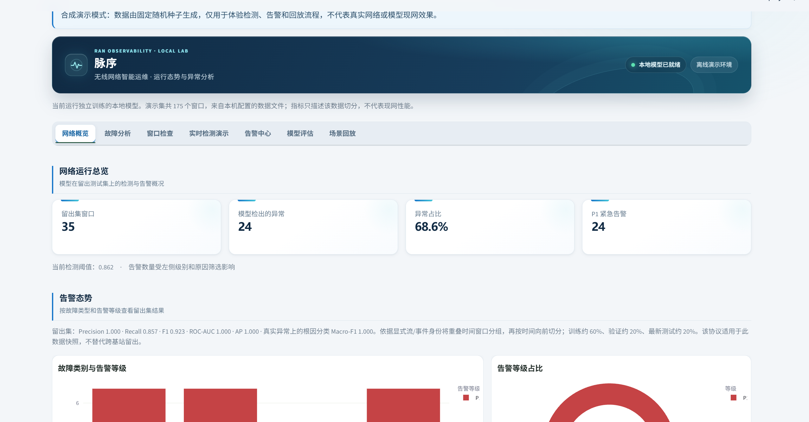
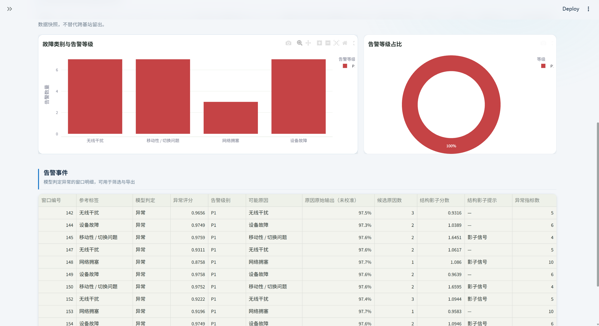

# RAN Monitor AI

面向 5G 无线接入网 KPI 的异常检测与故障分析演示项目。输入一个 128 个采样点、16 项连续 KPI 的窗口，输出正常/异常、可能故障原因、P1–P4 级别、受影响 KPI 和处理建议。包含中文 Streamlit 仪表盘、窗口回放、JSON 实时检测和可选邮件/WhatsApp 通知。



<details>
<summary>查看告警分析与明细表截图</summary>


</details>

## 本项目与参考项目

本项目的功能设计参考了 [TAB-0705/5G_RAN_Anomaly_Detection](https://github.com/TAB-0705/5G_RAN_Anomaly_Detection)，本仓库没有包含该项目的源文件或模型。项目曾使用 [TelecomTS](https://huggingface.co/datasets/AliMaatouk/TelecomTS) 的本地开发子集，但仓库不分发该数据或评估切分；真实数据训练需由使用者从上游单独取得并准备兼容的 JSONL 文件。许可和来源边界见 [DATA_SOURCES.md](DATA_SOURCES.md)。

项目源代码采用 MIT 许可证，见 [LICENSE](LICENSE)。该许可证不覆盖数据集或第三方依赖；请分别遵循其许可。

系统各模块之间的数据路径见[架构说明](docs/ARCHITECTURE.md)。

## 功能

- **异常检测**：监督式 XGBoost，提供均衡、高召回、高精确三种验证集校准策略；页面显示各自阈值与验证表现。
- **故障分类**：只对检测出的异常运行第二阶段分类；分类器只用 KPI 时序特征，不读取故障标签或场景标签，降低标签泄露风险。训练权重按故障类别和不重叠时间组均衡，减少重复窗口支配训练；`scripts/compare_cause_weighting.py` 仅使用训练组做交叉验证对照。
- **数据与评测**：审计采样率、单位、模式版本、数据来源及网络实体/事件身份；身份和最新时间块覆盖充分时按时间向前切分，否则按不重叠时间组分层留出并明确限制。
- **不确定原因**：保留分类器原始输出，增加温度缩放和 APS 式候选集合；校准证据不足时界面会标明限制并要求复核，不宣称覆盖率保证。另提供基于训练 KPI 原型距离的影子候选排序，单独展示而不伪装成概率。
- **告警分级**：P1–P4 只依据偏离 KPI 数、BLER、吞吐下降等观测影响，不由模型猜测原因单独触发；仍附原因候选、指标基线和团队建议。
- **结构异常影子通道**：用正常训练窗口的相关/时滞关系原型发现可能的未知结构变化，展示分数与偏离关系，不参与告警判定；晋级前需独立消融。
- **网络概览**：告警数量、级别分布、原因分布和告警明细。
- **故障分析**：展示四种原因相对正常窗口的 KPI 偏离热图。
- **窗口检查**：查看 KPI 时间曲线、正常训练窗口均值基线和正常样例叠加对比；可计算推高或降低异常分数的树模型特征贡献。
- **实时检测**：从本机数据选取窗口或上传兼容 JSON；整批推理保留输入顺序，可选择只预览或保存异常，下载 CSV、完整 JSON 与离线 HTML 报告。
- **告警中心**：支持关键词、级别、原因、状态筛选与分页；稳定流 ID 与时间戳可把相邻异常窗口归并为持续事件，三个递进正常窗口确认恢复；事件与窗口告警分别处置并写入审计记录。
- **人工原因复核**：追加已核实原因、可信度、复核人和依据，并关联模型版本；可用 `scripts/compile_reviewed_feedback.py` 按 `window_id` 关联原始 KPI，生成待审核的数据版本。冲突原因和低可信度记录会跳过，应用不会自动训练或覆盖冻结测试集。
- **模型评估**：展示异常检测、故障分类和两阶段端到端表现；阈值按验证集目标误报率或召回率校准，再由当前留出集诊断；展示 Precision–Recall 曲线和 AP，报告 Brier/ECE 及校准候选集合诊断，并按显式标注的数据来源分组审计。该留出集已用于开发诊断，最终成绩需要新的冻结测试数据。
- **评估不确定性**：对留出测试集按不重叠时间组进行分组自助抽样，报告 Precision、Recall、F1、ROC-AUC 和 Average Precision（AP）的 95% 区间；AP 补充呈现不平衡异常数据下跨阈值的精确率/召回率权衡。另做时间覆盖审计，明确区分重叠窗口隔离和未来/事件级泛化能力。
- **分数漂移监测**：滚动比较最近最多 100 个唯一窗口与正常验证窗口分数；稳定数据流 ID 可将监测状态写入本机 SQLite，跨刷新恢复。最少积累 30 个窗口后启动 KS 检验，偏移只提示复核，不自动改模型。
- **漂移监测基准**：`drift-benchmark` 从固定验证集分数生成稳定、均值偏移、方差扩张、告警激增四类可复现流，评估误报概率、检测率和发现延迟；模拟成绩不代表现网准确率。
- **模型基线比较**：`compare-detectors` 在同一分组切分和验证集目标召回率下比较监督式 XGBoost 与只用正常训练窗口拟合的 Isolation Forest，测试集不参与阈值选择，并报告分组置信区间与推理延迟。
- **模型晋级门禁**：`promotion-check` 检查测试集规模、来源标注、基站/事件身份、不确定性区间和评估协议；只有真正使用时间向前留出时才满足泛化证据门槛。证据不足会返回非零退出码并列出暂缓原因，不会自动部署模型。
- **连续回放**：按固定间隔处理混合或指定故障场景，可暂停、继续、导出；默认不保存告警。
- **模型更新**：校验数据、特征与训练代码的指纹，变化后自动重训；模型与评估指标存于同一快照，并原子替换旧模型。
- **确定性复现**：`scripts/verify_reproducibility.py` 在配置的数据集上连续重训两次，核对模型 ID、完整指标和抽样窗口输出；结果写入忽略跟踪的 `artifacts/reproducibility-latest.json`。
- **上传保护**：服务端限制单文件最大 10 MB；单次批量处理最多 100 个窗口，并在解析失败时提示 JSON 行列位置。
- **可选通知**：配置 SMTP 邮件或 Twilio WhatsApp 环境变量后启用；每次检测按渠道发送一条符合级别筛选的汇总通知。

仓库内的 `sample_window.json` 是由项目生成的合成推理样例，不用于训练。此前基于本地 TelecomTS 子集得到的评估数字和切分清单不随仓库提供，也不能在干净克隆中复现；历史数据与评估边界见 [模型卡](MODEL_CARD.md) 和 [工程与评测说明](docs/ENGINEERING_NOTES.md)。

要复现仅使用训练分区的根因类别/时间组权重对照：

```powershell
python scripts/compare_cause_weighting.py --folds 3 --seed 42
```

## Windows 本地运行

需要 Python 3.11 或更高版本。

想先体验界面而不准备真实数据：克隆仓库后安装依赖，运行合成演示。首次启动会用固定随机种子生成 175 个带明确 `synthetic` 来源标记的窗口，并训练项目的两阶段模型；检测、告警、评估和回放使用同一套应用代码。它不读取 TelecomTS，不代表现网表现。模型、数据和告警数据库写入单独的系统临时目录，演示时不会读取 `.env` 或发送邮件/WhatsApp 通知。

```powershell
python -m venv .venv
.venv\Scripts\Activate.ps1
pip install -r requirements.txt
python -m ran_monitor_ai demo
```

浏览器打开 `http://127.0.0.1:8504/`。默认端口被占用时可运行 `python -m ran_monitor_ai demo --port 8505`。终端会显示本次演示数据和告警数据库的临时目录。

真实训练数据需由使用者从 [TelecomTS 官方数据页](https://huggingface.co/datasets/AliMaatouk/TelecomTS) 单独获取，并整理为每行一个窗口的项目 JSONL 格式。数据卡元数据将许可标为 MIT，但上游文件列表没有单独的 LICENSE 文件；本仓库因此不分发 TelecomTS 样本、固定评估切分或基于其训练的模型。使用数据前请查看上游当前许可与条款。仓库根目录的 `sample_window.json` 是项目生成的合成推理样例，不用于训练真实数据模型。

```powershell
cd ran-monitor-ai
python -m venv .venv
.venv\Scripts\Activate.ps1
pip install -r requirements.txt
$env:RAN_MONITOR_DATA_PATH = "C:\data\telecomts_demo.jsonl"
python -m ran_monitor_ai.train
streamlit run app.py --server.port 8504 --server.address 127.0.0.1
```

也可以在 `.env` 中设置 `RAN_MONITOR_DATA_PATH`。首次训练会从该路径生成模型和评估指标，保存在 `artifacts/`；输入数据、代码与依赖版本匹配时会复用模型。数据文件应包含 16 项数值 KPI、每项 128 个采样点、有效的开始/结束时间，以及正常和四种故障原因标签。字段定义与示例见下文。

浏览器打开 `http://127.0.0.1:8504/`。先在“实时检测演示”选择样例、策略并运行，再到“告警中心”查看已保存的异常。想观察连续评分变化，可打开“场景回放”。修改 Python 模块或本地配置后请重新启动服务。

数值库的默认线程数限制为 4，减少本地程序的线程和内存开销；已明确设置的 `OPENBLAS_NUM_THREADS`、`OMP_NUM_THREADS` 等环境变量会优先保留。

## JSON 窗口格式

实时检测支持单个对象或对象数组。每个对象须含 `KPIs`，其中 16 项 KPI 各含 128 个有限数值；`labels` 里的 `zone`、`application`、`mobility`、`congestion` 用作分析上下文，不参与异常检测或根因分类。区域和业务场景可用于选择正常均值基线。

```json
{
  "sample_id": 123,
  "stream_id": "lab-cell-01",
  "event_id": "optional-labeled-incident-42",
  "start_time": "2026-10-13T10:00:00+08:00",
  "end_time": "2026-10-13T10:00:12.7+08:00",
  "KPIs": {"RSRP": [-73.0, "... 其余 127 个点 ..."]},
  "labels": {"zone": "A", "application": "File", "mobility": "No", "congestion": "No"}
}
```

`stream_id`、时间字段可选填写为可信数据身份；填写稳定的 `stream_id` 后，应用可跨刷新保存监测状态并归并相邻告警。不要用文件名、场景名或临时会话号代替基站/数据流身份。`event_id` 仅在数据源确实提供时填写，训练时按全数据集范围解释为全局事件 ID；如果上游只保证流内唯一，请先用流 ID 组成命名空间，避免不同流的同名事件被误合并。缺少流 ID 的窗口会与时间重叠的已知流窗口保守合并；这可能减少可用评测组，但不会把潜在重叠静默拆开。仓库中的 `sample_window.json` 是项目生成的合成推理样例，没有真实基站身份。

输入原始 KPI 值，遵循所用数据源中对应指标的含义和单位。布尔 KPI、重复 JSON 字段、NaN/Infinity、过大而无法稳定计算的数值都会被拒绝。`sample_id` 可省略，上传时自动编号；填写时须为整数或不超过 200 字的文本。

图上的 ±3σ 阴影是**正常窗口均值**的参考范围，并非单个采样点的告警阈值。树模型贡献解释预测的计算依据，不能直接证明故障原因。

## 命令行工具

在项目目录、已激活环境的终端中运行：

```powershell
python -m ran_monitor_ai detect sample_window.json --output artifacts/result.json
python -m ran_monitor_ai detect sample_window.json --policy sensitive --format html --output artifacts/report.html
python -m ran_monitor_ai detect sample_window.json --save-alerts --db artifacts/demo-alerts.sqlite3 --format csv --output artifacts/result.csv
python -m ran_monitor_ai evaluate --output artifacts/evaluation.json
python -m ran_monitor_ai compare-detectors --target-recall 0.90 --seed 42 --output artifacts/detector-comparison.json
python -m ran_monitor_ai promotion-check --output artifacts/promotion-check.json
python -m ran_monitor_ai drift-benchmark --runs 500 --horizon 200 --batch-size 10 --seed 42 --output artifacts/drift-benchmark.json
python scripts/leave_one_cause_out.py --target-fpr 0.05 --output artifacts/leave-one-cause-out.json
python -m ran_monitor_ai backup --output artifacts/backup.sqlite3
```

检测默认不保存告警，且命令行不会发送通知。`--policy` 可选 `balanced`、`sensitive`、`precision`。导出文件须与输入文件不同。数据库路径默认读取 `RAN_MONITOR_DB_PATH`，未设置时使用项目内的 `alerts.sqlite3`。

历史 690 窗口开发子集运行 `promotion-check` 会输出暂缓报告并返回退出码 `2`，因为缺少来源、流/事件 ID、测试窗口数不足，且评估采用分层重叠组留出而非时间向前测试；这是预期的证据门禁结果。新数据的结果取决于实际标签与身份字段。

若告警中心已导出人工原因反馈，可用原始 JSONL 中相同的窗口编译待审查版本：

```powershell
python scripts/compile_reviewed_feedback.py --source-jsonl data/telecomts_demo.jsonl --feedback-json artifacts/feedback.json --output data/reviewed_cause_v1.jsonl --report artifacts/reviewed_cause_v1-report.json
```

复核人必须填写；只有高/中可信度且窗口身份完全匹配的反馈会进入输出。它还不是可直接训练的完整数据集，仍须检查冲突、许可、时间划分和是否触碰冻结测试数据。更改演示数据后，请先审查新分布，再运行 `python scripts/freeze_development_split.py` 生成新的开发切分清单；原清单和指标应先留档。

## 验证与维护

```powershell
python -m unittest discover -s tests -v
python scripts/benchmark.py
python scripts/verify_reproducibility.py
python scripts/soak.py --seconds 300 --interval 10
```

单元、CLI、模型解释与 Streamlit 工作流测试使用固定种子的纯合成窗口和独立临时数据库，不依赖 TelecomTS，也不会发送外部通知。真实数据训练与开发评估结果无法通过该合成夹具复现。持续检查使用 `artifacts/soak-*.sqlite3`，检查重复检测一致性、批量保存、幂等写入、状态变化与备注，不写入日常告警历史。性能、运行与漂移基准报告保存于 `artifacts/`。

确定性复现脚本会在 `artifacts/` 内重新构建模型两次，并替换本地模型快照；它不修改数据文件或告警数据库。运行前须提供训练数据。该检查覆盖当前依赖版本与机器，不承诺跨平台逐位一致。

GitHub Actions 在 Ubuntu 和 Windows 上分别验证 pandas 2.x 与 3.x，编译应用、脚本和测试并运行完整测试套件。

面试项目讲解、可复现实验命令和简历表述见 [面试讲解提纲](docs/INTERVIEW_GUIDE.md)。

公开到 GitHub 前的作者信息、代码/数据许可、仓库卫生和演示步骤见 [发布检查清单](docs/PUBLISHING_CHECKLIST.md)。

实验脚本 `scripts/compare_temporal_models.py` 只使用训练分区内的重复分组交叉验证比较分类模型。新时序特征的汇总验证结果没有支持替换现有模型，因此实验特征保留在 `scripts/experimental_features.py`，没有启用于实际检测。

训练数据必须有有效、统一时区口径的开始/结束时间，并包含正常和四类故障。无法构造独立且覆盖类别的划分时会报错，不会退回可能泄露的随机窗口切分。

## 通知配置

复制 `.env.example` 为 `.env` 并填入 SMTP 或 Twilio 凭据。邮件密码和 Twilio token 不要提交到 GitHub。应用只在用户启用相应通知且告警达到所选级别时发送。带 `#` 的凭据与带空格的路径可用引号包裹；修改后重启应用。
