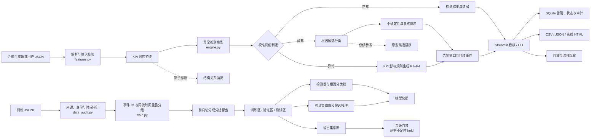

# 系统架构与数据流

本图描述本地演示和单机部署时的数据路径。演示模式通过 `demo.py` 生成合成 JSONL，并把数据、模型与 SQLite 文件放在独立临时目录；真实训练由使用者通过 `RAN_MONITOR_DATA_PATH` 提供数据。

## 关键边界

- 异常分数来自 KPI 特征；故障标签、事件标识和上下文标签不作为检测/根因特征。
- 阈值与校准只从训练流程中的验证分区确定。最终泛化结论需要开发过程未使用的冻结测试数据。
- 根因模型产生候选，不给出因果结论。P1–P4 由观测到的 KPI 影响规则计算。
- 原型排序与结构偏离保留为影子诊断，不参与告警判定。
- 合成演示只验证软件路径。生产晋级还需要有许可的真实标注数据、实体/事件身份和按时间前向评测。
