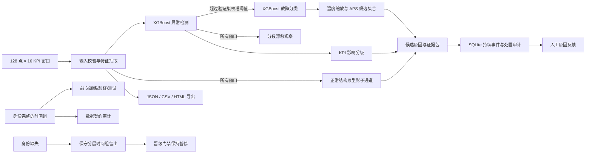

# 工程与评测说明

这份说明记录项目的实现边界、可复现实验和面试时应当如实讲清楚的限制。项目是对公开 5G KPI 异常检测问题的独立实现；参考资料用于技术选型和评测设计，不等于复制其代码或实验结论。

文中具体的开发集数值来自旧的本地 690 窗口 TelecomTS 子集。当前仓库不含该数据、固定切分或模型快照，因此这些结果无法通过干净克隆复现；请把它们当作历史实验记录，而非当前发布版的性能承诺。

本文件中带具体数字的漂移、性能和 Isolation Forest 基准来自旧模型快照 `f0393eafca95`。这些结果是历史记录，不代表当前发布模型重新测得的结果。当前模型格式为 9；默认演示每次从项目生成的 175 条纯合成窗口训练，数据、模型和告警数据库不随仓库分发。用途与限制见[最新模型卡](../MODEL_CARD.md)。

## 系统结构



在线检测路径不调用 LLM。异常门控和故障分类分为两个问题；阈值只由验证集确定，测试标签不用于调参。原因分类同时保留原始输出和单参数温度缩放结果，并以 APS 式集合给出候选原因。温度参数与 APS 阈值尽量使用不重叠的验证时间组；没有独立组时温度固定为 1。当前校准样本太少且窗口存在依赖，候选集合状态为“证据不足”，不声称保形覆盖率。温度缩放后的 Brier/ECE 只用于对照，不自动覆盖原始结果。告警分级只使用观测到的 KPI 影响证据；模型原因不能单独触发 P1。结构关系通道只在影子模式中输出关联变化，不称为因果图，也不影响告警。

## 评测协议和结果

样本有 128 个连续时间点、16 个 KPI。当前训练会按同一事件 ID、同一数据流的时间重叠和缺少流身份时的潜在重叠构造分组；满足身份与时间覆盖条件时检查完整组边界并前向切分，否则保留分组边界进行分层留出。历史 690 窗口子集及其开发指标没有随仓库发布；该子集的最后区块没有异常且缺少基站/流/事件身份，历史测试因此不能证明未来泛化。Precision、Recall、F1、ROC-AUC 和 Average Precision（AP）的区间按重叠时间组做 500 次 cluster bootstrap，以保留组内窗口的相关性。AP 用于补充观察不平衡异常数据下跨阈值的 precision-recall 权衡。默认 175 条合成演示数据只验证软件工作流，不构成真实网络性能评测。

历史本机开发子集曾有 690 个窗口和 420 个重叠时间组。`data/evaluation_split_dev.json` 曾通过数据 SHA-256 固定训练/验证/测试索引（397/142/151）；该数据和切分未随仓库发布，也不是未查看的最终测试集。时间覆盖审计显示故障标签集中在较早区块，最后两块没有故障；记录也没有基站、流或事件 ID。因此该历史实验不能解释为独立事件或同一基站的未来泛化结果。要做部署级时序评估，仍需带有身份、来源和新故障轨迹的数据。

前向评测的数据审计只接受 cell、site、entity、network-element 或 stream 一类持久网络实体标识；`scenario_id` 只描述测试场景，不能证明样本来自同一基站/数据流。事件 ID 也单独要求完整覆盖异常窗口。

带有稳定流 ID 的新检测窗口会将最近 100 个唯一分数、累计观察数和模型/参照版本保存到本机 SQLite；相同窗口 ID 会跳过。若没有流 ID，则只在本次 Streamlit 会话内观察。告警也拆分为请求 ID、内容哈希窗口 ID 和持续事件 ID。事件合并要求显式流 ID、有效窗口时间及相邻区间支持；缺少身份时每条告警保持单独事件。连续 3 个时间递进、未超过异常阈值的窗口会把事件标记为 `RECOVERED`，窗口告警仍可单独处置。人工原因反馈通过追加记录保存，并关联模型版本，不会直接改变模型标签或自动训练。

结构影子通道从正常训练窗口构造即时和滞后相关关系向量，用稳健尺度和最多 3 个 KMeans 原型衡量离群距离。本轮已在开发切分执行留一故障类别实验，并用验证正常窗校准相同 5% 误报预算，比较 XGBoost、结构分数及融合；另按训练正常流量均值四分位数审计测试正常窗误报。数值见优化验证记录。Mobility 留出类没有检出，Interference 融合测试误报率超过预算，流量子组也有波动，因此结构通道和多信号融合仍留在影子模式。

原因分类器现在按故障类别和训练分区内的重叠时间组均衡样本权重。3 折 StratifiedGroupKFold 训练组交叉验证中，Macro-F1 从逐窗口等权的 0.527 提升到 0.595，拥塞召回从 0.333 提升到 0.667；但训练集只有 3 个拥塞组，结果仍不稳定。对照可由 `scripts/compare_cause_weighting.py` 重现，验证和测试标签不参与交叉验证。

原因候选排序实验以训练异常窗口建立稳健 KPI 原型，在验证集选择分类器与原型名次的融合权重。当前选择 100% 分类器权重；原型距离仅供解释，排序分数不是概率。类别与时间组均衡后的当前开发留出 Top-1 / Top-2 为 0.659 / 0.902；这反映分类器加权训练后的结果，原型没有额外贡献。

人工反馈可由 `scripts/compile_reviewed_feedback.py` 按稳定 `window_id` 与原始 JSONL 关联。只纳入具名且高/中可信度的复核，冲突标签会跳过；输出仍需数据负责人审核、许可核对和分区，训练不会自动读取。当前数据库尚无可用于评估或训练的真实反馈样本。

漂移基准运行命令：

```powershell
python -m ran_monitor_ai drift-benchmark --runs 500 --horizon 200 --batch-size 10 --seed 42 --output artifacts/drift-benchmark.json
```

该命令固定模型验证集分数作为参照，通过 bootstrap 构造稳定、均值偏移、分数扩张、异常分数激增四类流，并模拟每批 10 个窗口的在线更新。报告每种场景的误报流比例及 Wilson 95% 区间、漂移检测率和检测延迟分位数。参考运行（模型版本 `f0393eafca95`，500 条/场景，200 窗口/流）结果为：稳定流 500 条均未触发，误报率 95% 区间上限约 0.76%；均值偏移检测率 100%，中位延迟 30 窗口；分数扩张检测率 99.4%，中位延迟 70 窗口；异常分数激增检测率 92.6%，中位延迟 80 窗口。

这些受控分布变换只回答“当前分数监测逻辑在这些人工场景下表现如何”，不是 TelecomTS 或运营商实测结果。比较近期变化时要保留随机种子、模型 ID、窗口数和批大小，避免只挑有利的场景汇报。漂移表示分数分布变化；没有人工标签时不自动重训。

本地性能基准使用 3 次预热、20 次 100 窗口批量推理重复测量，并记录操作系统、Python、数值库版本、线程池和内存。模型版本 `f0393eafca95` 在 Windows 11 / Python 3.12.14 上测得中位端到端批次 0.328 秒、约 305 窗口/秒，第 95 百分位 0.355 秒；690 窗口特征抽取的 3 次中位时间为 1.86 秒。旧的一次性性能快照用于特征/决策等价性比较，最多只用于判断改进方向，不据此声称严格加速比例；耗时会随本机负载和电源状态变化。该旧快照的 5 分钟持续运行检查完成 150 轮、15,000 个窗口、2,915 条告警写入，批量处理、幂等写入、状态审计和分页统计均未触发断言；Python 跟踪堆峰值 4.3 MiB、进程工作集峰值约 343 MiB。这不等于并发生产压测或 SLA。

模型基线比较运行命令：

```powershell
python -m ran_monitor_ai compare-detectors --target-recall 0.90 --seed 42 --output artifacts/detector-comparison.json
```

这项实验复用同一训练、验证、测试分组。XGBoost 使用带标签训练窗口；Isolation Forest 只使用正常训练窗口拟合。两者都在验证集上按相同的 90% 目标召回率选阈值，再在同一测试集上评估，并各自用 500 次组 bootstrap 给出区间。旧模型快照 `f0393eafca95` 的 XGBoost 测试 F1 为 0.863（95% CI 0.768–1.000）、AP 为 0.981（95% CI 0.950–1.000），精确率 0.957、召回率 0.786；Isolation Forest F1 为 0.542（95% CI 0.217–0.746）、AP 为 0.465（95% CI 0.133–0.742），精确率 0.382、召回率 0.929。该快照中前者误报更少，后者召回更高；样本很小且区间较宽，因此这只能作为历史模型选择线索。CPU 推理时间按 3 次预热、15 次重复，在 152 个测试窗口的批次上测量；旧快照的中位值为 XGBoost 0.205 毫秒/窗口、Isolation Forest 0.072 毫秒/窗口，数值依赖本机硬件，不应当作部署 SLA。

`promotion-check` 将测试规模、来源覆盖、流/事件身份、合法的 F1 分组区间和评估协议作为机器可读门槛。模型门禁会拒绝 NaN、非数值、越界和倒置的区间。当前训练指标使用分层重叠组留出，门禁明确要求 `forward_time_holdout`，因此只补齐元数据仍不能通过；必须先有真正的时间向前测试。当前数据会返回 `hold` 并以退出码 2 阻止 CI 误把演示成绩当作可晋级模型；报告会保留具体失败项。门禁默认要求显式来源覆盖 `synthetic` 与 `controlled_real`，参数可按部署场景调整。

模型复现检查运行 `python scripts/verify_reproducibility.py`。该脚本在相同数据和代码上强制重训两次，比较内容指纹产生的模型 ID、规范化评估 JSON 的 SHA-256，以及 20 个固定抽样窗口的检测分数、判定、根因和概率；报告同时记录操作系统、Python、NumPy、pandas、SciPy、scikit-learn 与 XGBoost 版本，并落入被忽略的 `artifacts/reproducibility-latest.json`。2026-10-13 的历史本机开发快照重建耗时 9.745 秒，模型 ID `bcc06b217d05`、指标摘要 SHA-256 `474aa48e17a3552518092deddb5f071f40a89e032a0ffcdece0ac14b777f717c` 和 20 个探针预测均一致。该数据和快照没有随仓库发布；这条记录不表示当前合成演示模型的重建耗时。此检查只证明原数据、库版本与环境内的可重复性。

## 近期技术路线参考

- [KPI-Aware Multimodal Anomaly Detection for 5G and Open RAN Telemetry](https://github.com/ChimanSalavati/kac-telecom-anomaly-detection)（2026）研究 KPI 预测残差和 KPI 级文本摘要的互补性，并将 LLM 放在离线摘要生成环节。这个项目保留轻量推理路径；若以后评估 Chronos 等时间序列基础模型，应使用同一切分、同一阈值协议和消融实验，不直接套用其论文成绩。
- [StrAD streaming TSAD benchmark](https://github.com/magaliparrino/StrAD)（KDD 2026）按“先训练、后在线评测”统一比较静态和流式方法，报告静态方法在多数场景下更强。这里用漂移观察告警输入分布改变，但不因“在线”而假设自动更新一定更好。
- [River 漂移检测评测路线讨论](https://github.com/online-ml/river/issues/1914) 把检测器评测基准列为重要缺口，并强调检测延迟、误报和漏报等可辩护指标。本项目据此增加了基于已知分布变化的漂移监测基准。
- [TelecomAudit origin-aware benchmark](https://github.com/ChimanSalavati/telecomts-real-synthetic-gap) 报告合成训练到受控真实 Jamming 的迁移差距，并建议按数据来源分层评估。本项目沿用其评测问题意识，但没有复用代码或结论；当前数据来源未显式标注，故结果仍标为未知且不会声称 synthetic-to-real 泛化。
- [时间序列异常评测审计](https://github.com/UsmarHaider/outliar) 展示了 point-adjusted F1 对偶然命中的放大效应。因此本项目不报告 point-adjusted F1；当前标签是窗口标签，使用普通窗口指标并展示分组不确定性。
- [TelecomTS 数据卡](https://huggingface.co/datasets/AliMaatouk/TelecomTS) 和 [ICML 2026 论文](https://proceedings.mlr.press/v306/feng26s.html) 说明上游数据来自 5G 测试床，保留 KPI 绝对尺度，并同时包含合成异常和一个真实干扰事件。旧本地实验使用了 690 窗口子集；当前仓库不分发该子集，且旧记录没有可用于本地评测的实体身份字段。来源审计只读取显式来源标签，不根据故障类别猜来源。

## 简历项目表述草稿

> 实现中文 5G RAN KPI 异常监测平台（功能设计参考公开的 RAN 异常检测项目）：以 128 点 × 16 KPI 窗口训练两阶段 XGBoost 检测/故障分类模型，按验证集校准告警阈值，提供 SQLite 处置审计、批量 CLI/JSON/CSV/HTML 导出和分数漂移观察；以不重叠时间组留出、Brier/ECE 置信度诊断、组级区间、Isolation Forest 基线比较和每场景 500 次漂移实验检查模型行为。默认演示用固定种子生成纯合成窗口，面向功能验证。历史开发集指标来自未公开的 690 个窗口，缺少基站/事件 ID，不能从干净克隆复现，也不代表现网效果。

建议面试时现场运行 `evaluate` 和 `drift-benchmark`，解释一次误报/漏报的处置过程，并说明为何当前数据不足以证明未来基站泛化。不要将模拟结果包装成运营商实测或把上游参考项目的结果写成本项目成绩。

## 本轮路线实施记录

- 已加入可选的流/事件身份审计；有完整实体/事件和时间覆盖时走前向切分，否则保留原有的不重叠组分层留出。旧开发数据缺身份和最新故障窗口，因此没有“最终冻结测试集”。
- 已加入温度缩放、APS 式候选集合和集合覆盖/大小/复核率的报告。当前模型验证集只有少量异常窗口，程序将温度缩放标成实验值，并持续要求人工复核，不宣称保证覆盖。
- 告警严重度已与分类原因解耦，现由吞吐下降、BLER 与 KPI 偏离数量触发。
- 已加入正常关系原型的结构影子通道、显式流 ID 驱动的持续事件与三窗恢复、SQLite 持久化分数观察及版本化人工复核反馈。
- 当前已查看的留出集只是开发诊断；需新数据、时间向前冻结测试、结构/事件消融和真实复核标签后，才能评价晋级。新变化尚未得到本轮运行检查的支持，指标和行为不得先写成已验证成绩。
