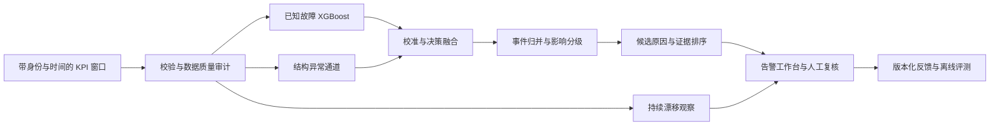

# 脉序：机制与功能优化方案

研究日期：2026-10-13。重点检索区间：2026-07-13 至 2026-10-13，同时核对必要的较早研究和官方实现。

本文是 2026-10-13 的研究与开发快照，记录当时的实现方向、数据和实验边界。表格及模型 ID `bcc06b217d05` 对应模型格式 8 和未随仓库发布的 690 窗口本机开发子集；这些不是当前可复现的发布基准。当前公开候选使用模型格式 9 和运行时生成的 175 条合成演示窗口，真实网络评测仍需独立数据。文中的验收目标不是已取得的成绩。

## 实施进度（2026-10-13）

| 阶段 | 当前状态 | 边界 |
| --- | --- | --- |
| 数据契约与划分 | 已加入身份/采样率/单位/来源审计，并用 SHA-256 清单固定开发集的训练、验证、测试索引 | 固定的是已查看的演示切分；缺真实实体/事件身份和最新故障，不能代替最终冻结测试集 |
| 原因校准与影响分级 | 已重建模型并报告原始/温度缩放 Brier、ECE、APS 集合和复核率；P1–P4 只按 KPI 影响评定 | 温度缩放在当前开发留出上变差；22 个 APS 样本、5 个时间组不足以给概率或覆盖率保证 |
| 持续事件与监测 | 已覆盖幂等请求、相邻窗口归并、三个递进正常窗口恢复；新增回归用例验证事件时间线 | 用的是受控用例，没有真实带标签的连续 RAN 流；真实事件召回和恢复延迟仍待数据 |
| 结构异常 | 已跑四类留一故障家族、共同验证误报预算下的 XGBoost/结构/融合对照及正常流量四分位误报审计 | 只在已查看的小型开发切分上做；Mobility 未检出，且子组误报波动，不进入告警 |
| 证据与反馈 | 告警已展示 KPI 原型辅助排序；新增将高/中可信度反馈按窗口身份关联到原始 KPI 的版本化整理工具 | 开发留出上排序未提升；反馈不会自动训练，需原始窗口、具名复核、冲突处理和数据负责人分区审核 |

2026-10-13 已重建模型 `bcc06b217d05`（格式 8）并运行了核心数据/训练/推理/事件/反馈测试。当前切分 F1 和实验数值见“实施验证结果”；演示留出集曾用于开发诊断，所有结果仍不能作为新的最终测试成绩。

## 1. 推荐方向

将项目发展为“具备未知异常发现、统计证据、事件管理与可复核诊断的 5G RAN 监测平台”。保留现有 XGBoost 作为轻量基线，优先修复诊断可靠性和评测条件，再引入结构异常检测。每个新模块都必须能通过独立消融说明自己的作用。

顺序：数据与评测 → 校准及拒绝判断 → 持续监测及事件归并 → 结构异常实验 → 证据化诊断及人工反馈。

## 2. 从本地源码和模型快照看到的问题

已核对 `features.py`、`train.py`、`engine.py`、`monitoring.py`、`store.py`、`governance.py`、实验脚本及 `artifacts/metrics.json`。

| 当前行为或证据 | 优化含义 |
| --- | --- |
| 690 个窗口，每个窗口为 16 KPI × 128 点；固定开发切分为 397/142/151 | 适合演示和初步对照，暂不足以证明部署泛化 |
| 本次测试检测 Precision/Recall/F1 均为 0.927；加权后端到端故障 Macro-F1 为 0.584 | 检测门控不错，但故障分类错误会明显降低最终诊断表现 |
| 测试集 Mobility 仅 4 个窗口：1 个正确、2 个漏检、1 个误分为 Equipment | 类别支持量太小，须补独立移动性事件，不能据此推断总体表现 |
| 设备故障分类会直接生成 P1 | 分类错误可能传递为严重度错误；告警影响与原因置信度应分别表达 |
| 验证集故障仅 17 个：拥塞 3、设备 5、干扰 6、移动性 3 | 不适合直接声称可靠的逐类别覆盖率或复杂后校准效果 |
| 原因概率尚未校准，人工复核条件是概率 <0.6 或前两名差距 <0.15 | 需要比较这些启发式条件与校准、集合预测、拒绝判断 |
| 只有 8 对预设相关系数，统计量以整个窗口汇总 | 可能遗漏时滞、短时关系变化和不同正常工况之间的差别 |
| 漂移检查为滚动分数的 KS 检验，状态保留在会话内 | 需要持续状态、重复监测的误报评测和 KPI 级定位 |
| 新推理生成新告警 UUID；数据库只对相同告警 ID 幂等 | 推理记录、重复请求和持续故障事件需要三个独立身份 |
| 无明确基站/流 ID、事件 ID、来源标注，最后两个时间区块无故障 | 无法可靠拼接连续轨迹，也不能据此宣称未来基站或独立事件泛化 |
| 以前新增的通用时序特征没有支持替换当前模型 | 新研究也只能作为实验假设，不能靠增加特征数量证明改进 |

这些数值来自当前本地演示快照，不能解释成现网结果。

## 3. 可用的前沿研究及适用边界

| 研究/实现 | 时间与核实状态 | 本项目采用的方向 |
| --- | --- | --- |
| [GSLAD](https://arxiv.org/abs/2609.15483) | 2026-09-14 预印本；未确认可直接复用的官方代码 | 正常工况结构原型和结构偏离评分；先做独立轻量对照 |
| [根因检索与重排序分解](https://arxiv.org/abs/2609.36686) | 2026-09-29；论文页面标注 NeurIPS 2026 接收；所给 DecompRCA 链接本次返回 404 | 将“候选缺失”和“候选排序错误”分开评估，再实验多信号候选与证据排序 |
| [LLM 生成特征池](https://arxiv.org/abs/2609.21801) | 2026-09-18 预印本；包含 Huawei Noah’s Ark Lab 作者署名 | LLM 仅在离线提出领域特征假设，人工审核后与专家特征做消融 |
| [nonconform](https://github.com/OliverHennhoefer/nonconform) | 更新日志记载 2026-08-11 加入顺序监控；[PyPI](https://pypi.org/project/nonconform/) 记载最新发布为 2026-08-19，要求 Python ≥3.12 | 保形异常证据和顺序交换性监控；锁定稳定版本，不依赖 `Unreleased` API |
| [MAPIE 集合分类](https://mapie.readthedocs.io/en/stable/content/conformal-prediction/classification/) | 成熟理论与官方实现，不包装成近三个月的新理论 | 在充分独立的校准数据上比较 LAC/APS 集合预测与拒绝判断 |
| [IBM 自适应保形 TSAD](https://arxiv.org/abs/2604.20122) 与 [代码示例](https://github.com/ibm-granite/granite-tsfm/tree/main/notebooks/hfdemo/adaptive_conformal_tsad) | 2026-04 研究，有官方示例 | 需要预测残差通道时的备选实验，优先与简单预测器比较 |

GSLAD 的学习图表示统计依赖，不等于被证明的因果图。特征池论文主要验证单变量任务，迁移到 16 KPI 是本项目需要验证的假设。根因分解论文研究传感器/组件定位，而当前项目主要有四类故障标签；两种任务须区分。

## 4. 具体机制设计

### A. 先建立可信的数据和实验协议

- 扩展上游 [TelecomTS](https://huggingface.co/datasets/AliMaatouk/TelecomTS) 导入器，但先检查完整数据是否真正提供实体、事件和来源信息。增加窗口数不会自动补齐这些信息。
- 统一 `stream_id`、窗口起止时间、采样率、数据来源、事件身份、测量单位和字段版本。缺失信息保留为未知；只有可证明连续且属于同一流的窗口才能拼接。
- 故障标签、描述、QnA、处置工单和 `anomaly_present` 不得进入检测输入。新测量上下文只有在运行时可取得且不会泄露目标时才可使用。
- 数据支持时建立按时间向前的训练、调参、独立校准、最终测试分区，并清除跨分区重叠和同事件泄露。跨实体泛化另做基站留出。
- 当前 152 窗口作为已查看的开发诊断集；最终成绩使用新的冻结留出集，避免反复针对旧测试错误调参。
- 当前已把开发切分索引与演示 JSONL 的 SHA-256 写入 `data/evaluation_split_dev.json`；若数据内容或顺序改变，训练会停止并要求重新审查清单。该清单只固定开发对照，不把开发集变成最终测试集。
- 若上游仍不具备所需身份，继续做窗口级实验；独立增加有明确事件身份的实验室采集或模拟轨道，并单独标注，不能伪装成运营商实测。

交付：数据契约、来源审计、切分清单、固定基线报告。

### B. 原因预测允许“不确定”，严重度依据影响证据

- 保留原始分数，同时新增校准后的原因概率。先比较少参数温度缩放和不校准；校准器只用专用数据拟合。
- 在数据规模允许时实验集合预测：单元素集合给出一个候选原因，多元素集合列出候选并要求复核；空集合只表示不支持已有类别判断，不能自动证明未知故障。
- 未校准分数、概率、保形 p 值、顺序证据是不同量，API 和界面分别命名。p 值不能写成“故障发生概率”。
- 严重度优先参考吞吐影响、持续时间、影响范围及 KPI 证据。设备故障类别可以提出高优先级排查建议，单个未经验证的分类结果不应成为唯一的 P1 依据。
- 数据不足或不满足校准适用条件时，显示“校准证据不足”，保留人工复核和现有基线，不能静默宣称 90%/95% 保障。

验收：Brier/ECE、各类覆盖率、集合大小、拒绝比例、风险—覆盖曲线、错误 P1 数量；报告拒绝案例，不从端到端指标中删除。

### C. 将窗口异常变成持续事件，并改进漂移观察

- 分开 `request_id`、`window_id`、`incident_id`。相同请求可幂等，相同流上的持续故障可归并，同时保留每个原始检测结果。
- 使用进入/退出不同阈值、持续性判断和恢复确认减少抖动；确凿严重影响可以绕过等待。阈值与等待时间在开发流上共同选定，同时测量新增延迟。
- 将监测状态按流、模型和证据版本持久化；处理重复窗口、乱序和模型升级时的重置，避免网页刷新丢失历史。
- 保留 KS 基线，对照顺序保形秩与 martingale 证据。扩展监测到 KPI 组和结构评分，区分输入变化、分数变化、业务工况变化；只有取得真实反馈标签后才评价性能变化。
- 常规保形方法需要交换性等条件。非重叠分块只能减轻依赖，不能自动证明这些条件成立。单流的 Ville 界也不能当作多基站 FDR 控制；多流需要单独选择和验证多重检验方案。
- 不因无标签漂移直接更新阈值或模型。先收集受影响区间、生成复核任务，并检查独立正常参照是否仍适用。

验收：长稳定流的“曾经误报”比例、重复查看下的误报、突变/渐变发现延迟、归并前后告警数、事件召回和重复通知率。没有真实事件标签时，不宣称事件召回成绩。

### D. 增加结构异常通道，逐步研究未知故障

- 现有 XGBoost 处理已知故障；新增一个正常数据驱动的结构异常通道，输出“偏离正常结构”的证据，而不是强行映射四类原因。
- 第一版独立实现轻量基线：正常窗口的稳健相关/时滞相关、多工况原型、经过收缩和方差下限处理的结构偏离分数。它借鉴 GSLAD 的问题意识，不命名为完整 GSLAD 复现。
- 数据和计算条件充足时，再比较完整动态图预测架构与轻量版本。工况原型只在训练正常数据上生成，评分融合权重只在开发集选择。
- 不直接对异质评分取最大值或简单 OR 后沿用旧阈值。融合器和新增通道须重新校准，并在同一误报预算下比较。
- 如引入时序基础模型，先以独立进程离线/影子推理测量成本和收益；与线性预测、轻量时序模型及正常训练 Isolation Forest 做公平对照。新模型不可用时回退到现有通道。
- 未知故障测试采用“留出一种故障家族”：从训练和调参中去掉该家族，再在冻结测试中评估；同时加入正常负载变化，防止把正常工况变化全判为未知故障。

验收：相同误报预算下的已知/未知召回、PR 指标、类别薄弱项、延迟、内存，以及去掉结构通道的消融。

### E. 证据化诊断与离线特征探索

- 对每个事件建立结构化证据包：异常起点、持续区间、KPI 偏离、特征贡献、关系变化、候选原因、反证及模型版本。
- 固定候选预算，例如四类原因中最多两个，分别评估检测门控召回、候选覆盖、条件排序正确率和整体诊断正确率。不能用“把四类都列出”制造候选召回 100%。
- 当前只能评价故障类型候选；KPI 排名展示为疑似证据。取得组件/根因位置标签后，才增加组件定位 Top-K 评测。
- 先做确定性的多信号排序，再可选对比只读取同一证据包的 LLM 排序。LLM 输出必须引用证据 ID，支持无法判断，并记录耗时和调用成本。
- 大模型离线提出特征候选，例如持续异常占比、指标变化先后顺序、资源利用与流量效率；人工核对单位、标签泄露与运行时可获得性。当前 `RX_Bytes / abs(RSRP_dBm)` 缺少直接的物理解释，需要消融，不能称为物理不变量。
- 已有频谱、差分、自相关实验没有支持上线；新特征必须在训练内部的分组/前向验证中与原特征、人工特征和合并特征比较。最终测试标签不提供给生成器。
- 新增“已确认原因”“确认依据”“标签可信度”“复核人”等反馈字段。解决告警不等于确认模型原因正确；只将可审计反馈写入版本化训练集。

验收：固定候选集的排序对照、证据引用有效率、拒答案例、端到端正确率、特征消融和成本。论文中的提升比例不移植为本项目成绩。

### 本轮实施验证结果（2026-10-13）

新模型在固定开发切分上：异常检测 F1 0.927（组级 95% CI 0.703–0.973），已知异常原因 Macro-F1 0.634，两阶段端到端故障 Macro-F1 0.584。训练分区内 3 折 StratifiedGroupKFold 对照中，按类别及重叠组均衡权重将 Macro-F1 从 0.527 提升到 0.595；拥塞召回从 0.333 提升到 0.667。训练集只含 3 个拥塞组，因此该选择仍需新数据验证。固定开发留出上，拥塞召回提升到 0.583，但设备召回从 0.833 降到 0.500；这组已查看数据不能作为独立泛化结论。当前 APS 校准仅有 22 个校准样本、5 个不重叠组；测试候选平均包含 3.56 个原因，复核率为 100%，因此状态保持“校准证据不足”。类别加权模型的温度缩放使原因 Brier 从 0.492 升至 0.603、ECE 从 0.162 升至 0.236；当前数据不支持启用这项后校准。

留一故障类别实验在每折中排除目标家族，并只用其他已知故障和正常验证窗选择结构融合权重；XGBoost、结构通道和融合都按相同的验证正常误报预算校准为 5%。冻结测试子集上的结果如下，支持量很少，且不同类别看到的测试正常窗相同：

| 留出故障 | 测试正例 | XGBoost 召回 / FPR | 结构召回 / FPR | 融合召回 / FPR |
| --- | ---: | ---: | ---: | ---: |
| Congestion | 24 | 0.792 / 0.027 | 0.542 / 0.027 | 0.875 / 0.036 |
| Equipment | 6 | 1.000 / 0.027 | 0.833 / 0.027 | 1.000 / 0.027 |
| Interference | 7 | 0.143 / 0.036 | 0.000 / 0.027 | 0.429 / 0.055 |
| Mobility | 4 | 0.000 / 0.027 | 0.000 / 0.027 | 0.000 / 0.027 |

这次小型实验提示结构通道可能帮助 Congestion 和 Interference，但融合在 Interference 上的测试 FPR 达 5.5%，Mobility 仍然漏掉全部样本。它不能证明稳定收益，结构通道继续留在影子模式。原因 KPI 原型排序在验证集选择了 100% 分类器权重；类别加权后测试 top-1 0.659、top-2 覆盖 0.902，与分类器自身相同，因此暂不启用重排。加权交叉验证结果可由 `scripts/compare_cause_weighting.py` 复现，该脚本不读取验证/测试标签进行选型。

现有代码已能把人工反馈按 `window_id` 关联到精确原始 KPI，冲突标签和低可信度记录会排除；编译产物仍标为待数据负责人审核，训练不会自动加载它。仓库没有真实反馈记录、严重度真值、跨基站事件轨迹或未查看的异常测试集，这些结论仍需新的数据支持。

## 5. 建议架构

## 6. 分批交付与晋级条件

| 次序 | 可演示交付 | 建议改动位置 |
| --- | --- | --- |
| 1 | 数据身份/来源审计、开发/最终测试区分、基线冻结 | `data_audit.py`、`train.py`、`governance.py` |
| 2 | 校准候选原因、不确定输出、影响与原因分开显示 | 新增 `uncertainty.py`；调整 `engine.py`、报告与界面 |
| 3 | 持续故障归并、恢复状态、持久化监测、重复请求处理 | 新增 `incidents.py`；调整 `monitoring.py`、`store.py` |
| 4 | 结构异常影子通道、留一故障实验、融合消融报告 | 新增 `structure_detector.py`、`detector_protocol.py` 与实验脚本 |
| 5 | 证据包、候选/排序评估、人工反馈、可选离线 LLM | 新增 `diagnosis.py`；扩展评测与处置记录 |

比较版本依次为：现有基线、仅校准、仅事件机制、仅结构通道、融合、证据排序。固定相同输入、数据分区和计算环境，分别测质量与成本。分组置信区间按真实实体/事件身份构造；不能把相关窗口当作独立重复实验。

晋级依据是预先约定的误报预算、薄弱类别表现、端到端质量和运行成本，而不是单一最好看的 F1。新模块未证明收益时保留为实验；当前晋级门禁的数据限制继续生效。

## 7. 第一批建议

先完成第 1、2 次交付：冻结当前基线，查清完整数据的身份/来源，修复原因置信度和严重度耦合。它们直接对应现有错误，也为后续前沿模型建立可解释的对照。随后第 3 次交付形成能演示完整故障生命周期的系统，再进入结构异常与证据诊断实验。

对面试的价值来自能演示并解释：为什么拒绝判断、如何控制误报、如何发现未知异常、如何区分检测和诊断失败，以及如何证明新模块比简单基线更好。引用最新论文的同时保留自己的实现、实验记录和负面结果。
